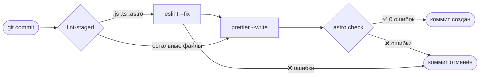
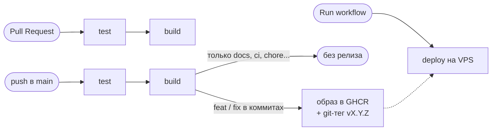

<div align="center">

# 🚀 project-starter-pack

**Шаблон Astro-проекта, где проверки, релизы и деплой на VPS уже настроены. Остаётся писать код.**

[](https://docs.astro.build)
[](https://www.typescriptlang.org)
[](https://nodejs.org)
[](eslint.config.js)
[](.prettierrc.json)
[](Dockerfile)
[](.github/workflows/ci.yml)
[](https://www.conventionalcommits.org/ru/v1.0.0/)
[](LICENSE)

[**⚡ Создать проект из шаблона**](https://github.com/nestreeLabs/project-starter-pack/generate)

</div>

---

## ✨ Что внутри

|     | Возможность         | Чем сделано                                                     |
| :-: | :------------------ | :-------------------------------------------------------------- |
| 🪐  | Фреймворк           | Astro 7                                                         |
| 🧱  | Базовый layout      | `Layout.astro`: CSS-переменные, сброс стилей                    |
| 🔤  | Шрифты              | Astro Fonts API, Inter из Google Fonts                          |
| 🎨  | Стили               | SCSS-модули (`style.module.scss`)                               |
| 🔎  | SEO                 | `SEO.astro`: title, description, canonical, Open Graph, Twitter |
| 🛡️  | Проверка типов      | `astro check` + TypeScript strict                               |
| 🔍  | Линтинг             | ESLint: JS, TypeScript, `.astro`                                |
| 🎨  | Форматирование      | Prettier с плагином для `.astro`                                |
| 🪝  | Проверки до коммита | husky + lint-staged                                             |
| 📝  | История коммитов    | Conventional Commits, описание на русском                       |
| 🐳  | Контейнер           | Docker, `@astrojs/node` standalone                              |
| ⚙️  | CI                  | GitHub Actions: lint, format, check, build                      |
| 🏷️  | Релизы              | версия и git-тег по коммитам                                    |
| 🚢  | Деплой              | вручную на VPS по SSH, образ из GHCR                            |

## 🏁 Быстрый старт

```sh
npm install      # ставит зависимости и сразу включает git-хуки
npm run dev      # → http://localhost:4321
```

> [!TIP]
> Нужен Node.js `>= 22.23.4`. Проверить версию: `node -v`.

## 🧰 Команды

| Команда                | Что делает                      |
| :--------------------- | :------------------------------ |
| `npm run dev`          | Dev-сервер на `localhost:4321`  |
| `npm run build`        | Сборка в `./dist/`              |
| `npm run preview`      | Локальный просмотр сборки       |
| `npm run check`        | Проверка типов                  |
| `npm run lint`         | Проверка стиля кода ESLint      |
| `npm run format`       | Отформатировать весь проект     |
| `npm run format:check` | Только проверить форматирование |

Запустить в Docker локально: `docker compose up --build -d`, сайт откроется на `http://localhost` (порт меняется через `HOST_PORT=8080`). Проверка сервера: `/api/health` отвечает `ok`.

## 🪝 Что происходит при `git commit`



- Проверяются **только файлы из коммита**, поэтому хук работает быстро.
- Исправления ESLint и Prettier **автоматически попадают в тот же коммит**.
- `astro check` проверяет типы во всём проекте: ошибка в одном файле может сломать другой.

> [!NOTE]
> Конфиги: [eslint.config.js](eslint.config.js), [.prettierrc.json](.prettierrc.json), раздел `lint-staged` в [package.json](package.json), хук в [.husky/pre-commit](.husky/pre-commit).

## 🗂️ Структура

```text
📦 project-starter-pack
├── ⚙️ .github/workflows/  CI/CD: test → build → релиз, деплой
├── 🪝 .husky/             git-хуки
├── 🖼️ public/             статика без обработки
├── 📁 src/
│   ├── ⚙️ @common/        системное, не UI: SEO/SEO.astro
│   ├── 🗃️ @data/          статичные данные: features.ts
│   ├── 🧩 @sections/      секции страниц: Hero/
│   ├── 🧮 @utils/         функции с логикой: seo.ts
│   ├── 🖼️ @views/         страницы целиком: Home/Home.astro
│   ├── 🧱 layout/         Layout.astro и common.css
│   ├── 📄 pages/          роуты, только подключают страницу из @views
│   │   └── api/health.ts  проверка, что Node-сервер жив
│   └── 🏷️ types.ts        все типы проекта
├── 🐳 Dockerfile
├── 🐳 compose.yml         один файл для локального запуска и сервера
├── ☁️ cloud-init.yml      первичная настройка VPS
├── ⚙️ astro.config.mjs
├── 🔍 eslint.config.js
├── 🎨 .prettierrc.json
└── 📦 package.json
```

## 🏛️ Архитектура

Страница собирается сверху вниз из слоёв. Каждый слой импортирует только слои ниже себя:

```text
pages/index.astro            роут: <Home />
  └── @views/Home            meta + <Layout {meta}> + секции
        ├── layout/Layout    html, head (<SEO />, шрифты), body со <slot />
        └── @sections/Hero   секция страницы
              └── @components  составные компоненты (собираются из @ui)
                    └── @ui      базовые элементы: кнопка, инпут, бейдж
```

| Папка                 | Что лежит                                                 | Алиас           |
| :-------------------- | :-------------------------------------------------------- | :-------------- |
| `pages/`              | роуты, внутри только импорт страницы из `@views`          | —               |
| `@views/<Page>/`      | страница целиком: `meta`, `Layout`, набор секций          | `@views/*`      |
| `@sections/<Name>/`   | секции страниц                                            | `@sections/*`   |
| `@components/<Name>/` | составные компоненты из `@ui`                             | `@components/*` |
| `@ui/<Name>/`         | базовые UI-элементы без логики                            | `@ui/*`         |
| `@common/<Name>/`     | системные вещи, не UI (`SEO`)                             | `@common/*`     |
| `layout/`             | `Layout.astro`, глобальные стили и CSS-переменные         | `@layout/*`     |
| `@data/`              | статичные данные: списки, тексты                          | `@data/*`       |
| `@utils/`             | чистые функции: принимают аргументы, возвращают результат | `@utils/*`      |
| `types.ts`            | все типы и интерфейсы                                     | `@types`        |

> [!NOTE]
> Папки `@ui` и `@components` появятся вместе с первым компонентом, алиасы для них уже есть в [tsconfig.json](tsconfig.json).

### Правила

- **`.astro` содержит только вёрстку.** Во frontmatter допустимы импорты, `Astro.props` и вызов готовых функций. Вычисления выносятся в `@utils`, данные в `@data`
- **Компонент живёт в своей папке:** `Hero/Hero.astro`, стили рядом в `style.module.scss`
- **Стили:** глобальные только в `layout/common.css`, у компонентов SCSS-модули (`class={styles.title}`). Без `<style>` в `.astro` и без inline-стилей, цвета берутся из CSS-переменных
- **Импорты только через алиасы**, без `../`
- **Типы** лежат в `src/types.ts`. Интерфейс с префиксом `I` (`ISEO`), type-алиас с префиксом `T` (`TSEO`). В `.astro` пишется `type Props = ISEO;`, это имя нужно Astro для проверки пропсов
- **Мета страницы** задаётся во view объектом `const meta: ISEO = {...}` и передаётся как `<Layout {meta}>`

### Как добавить страницу

1. Секция: `src/@sections/Team/Team.astro` и `style.module.scss`, данные для неё в `src/@data/`
2. Страница: `src/@views/About/About.astro` с `meta` и `<Layout {meta}><Team /></Layout>`
3. Роут: `src/pages/about.astro`, внутри только `<About />` из `@views/About/About.astro`

## 🚢 Релизы и деплой



**Версия** считается по коммитам с прошлого тега:

| В коммитах есть                        | Версия            |
| :------------------------------------- | :---------------- |
| `feat!:` или `BREAKING CHANGE:` в теле | `v1.2.3 → v2.0.0` |
| `feat:`                                | `v1.2.3 → v1.3.0` |
| `fix:`, `perf:`                        | `v1.2.3 → v1.2.4` |
| остальные типы                         | релиза нет        |

**Деплой** только вручную: **Actions → CI/CD → Run workflow**.

- `Use workflow from: main` выкатывает последнюю версию
- `Use workflow from → Tags → v1.2.0` выкатывает эту версию, так же делается откат

<details>
<summary>Первая настройка сервера</summary>

1. Создать deploy-ключ: `ssh-keygen -t ed25519 -f ~/.ssh/deploy_key -N "" -C deploy`
2. В [cloud-init.yml](cloud-init.yml) подставить содержимое `~/.ssh/deploy_key.pub` и вставить файл в поле Cloud-init при создании VPS. Он ставит Docker, создаёт пользователя `deploy`, папку `/opt/site` и открывает порты 22 и 80
3. В репозитории: **Settings → Environments → `production`**, добавить секреты:

| Secret            | Значение                                        |
| :---------------- | :---------------------------------------------- |
| `SSH_HOST`        | IP сервера                                      |
| `SSH_USER`        | `deploy`                                        |
| `SSH_PRIVATE_KEY` | содержимое `~/.ssh/deploy_key`                  |
| `SSH_KNOWN_HOSTS` | вывод `ssh-keyscan <IP>` (строки без `#`)       |
| `SSH_PORT`        | необязательно, по умолчанию `22`                |
| `APP_ENV`         | необязательно, переменные приложения для `.env` |

4. Сделать push с `feat` или `fix` и нажать Run workflow
5. Проверить `http://<IP>/api/health`, ответ `ok`

</details>

> [!NOTE]
> Серверный роут (не пререндеренный) включается строкой `export const prerender = false` в файле страницы, как в [src/pages/api/health.ts](src/pages/api/health.ts).

## 📝 Коммиты

Используется [Conventional Commits](https://www.conventionalcommits.org/ru/v1.0.0/): `type` и `scope` пишутся на английском, описание на русском в прошедшем времени. От типа коммита зависит [версия релиза](#-релизы-и-деплой).

```text
feat(pages): добавлена страница контактов
fix(docker): исправлена сборка образа
build: обновлены зависимости
```

<details>
<summary>Список типов</summary>

| Тип        | Когда использовать                  |
| :--------- | :---------------------------------- |
| `feat`     | новая функциональность              |
| `fix`      | исправление бага                    |
| `docs`     | документация                        |
| `style`    | только форматирование               |
| `refactor` | рефакторинг без изменения поведения |
| `perf`     | производительность                  |
| `test`     | тесты                               |
| `build`    | зависимости, сборка, Docker         |
| `ci`       | GitHub Actions                      |
| `chore`    | всё остальное                       |

</details>

## 🗺️ Roadmap

- [x] Astro + TypeScript strict
- [x] 🧱 Базовый Layout, шрифты и SEO-компонент
- [x] ESLint + Prettier
- [x] Pre-commit хук: lint-staged + `astro check`
- [x] 🐳 Docker-образ на `@astrojs/node` (standalone)
- [x] ⚙️ CI на GitHub Actions: lint, format, check и build на каждый PR и push в `main`
- [x] 🏷️ Автоматические версии и git-теги по Conventional Commits
- [x] 🚢 Ручной деплой на VPS по SSH через GHCR, доступы хранятся в GitHub Secrets
- [ ] 🔒 Домен и HTTPS (Caddy перед контейнером)
- [ ] 🗄️ База данных

## 📄 Лицензия

[MIT](LICENSE)
